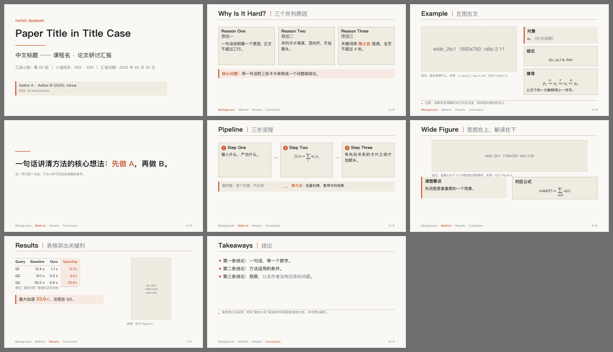

# Agent Skills · 学习、写作与协作

这里收集我与 AI Agent 共同编写、持续修改的 skills，涵盖编码与复核、复杂任务协作、Obsidian 课程笔记和学术幻灯片制作。

每个 skill 都包含可直接阅读的 `SKILL.md`，部分还提供参考规范、模板、脚本和示例。你可以先阅读指令，选择适合自己工作流的部分，再复制到所用 Agent 的技能目录中试用。

另收录九个带精炼英文路由入口的上游技能，覆盖代码库导读、网页测试、MCP 服务开发、CI 排错、文献引用、科研绘图、Obsidian 视图与画布、Jupyter 实验。全部 15 个技能的 `SKILL.md` 均统一为英文、控制在 8 KB 以内，且可使用根目录 `python3 -B scripts/audit_skills.py` 一键完成结构检查与全量单元测试。具体用途与来源见[工作区 README](../README.md)。

## 选择一个 skill

| Skill | 适合做什么 | 阅读入口 | 目录 |
| --- | --- | --- | --- |
| **Commander** | 拆解复杂任务、按能力路由执行通道、独立验收与整合成果（任意 Agent 通用） | [使用说明](../commander/README.md) · [完整指令](../commander/SKILL.md) | [commander/](../commander/) |
| **Coding Task Contract** | 开工前把需求写成范围、可观察的验收条件和验证计划 | [完整指令](../coding-task-contract/SKILL.md) | [coding-task-contract/](../coding-task-contract/) |
| **Verified Coding Loop** | 实现或修复时记录基线、实际检查、结果和仍缺的证据 | [完整指令](../verified-coding-loop/SKILL.md) | [verified-coding-loop/](../verified-coding-loop/) |
| **Agent Code Handoff** | 换执行者、设备或审查者时移交可获取的产物，按原验收条件独立复核 | [完整指令](../agent-code-handoff/SKILL.md) | [agent-code-handoff/](../agent-code-handoff/) |
| **Obsidian Self-Study** | 从课程课件与教材构建自学笔记，保留来源，组织公式、图片、复习索引与质量记录 | [使用说明](../obsidian-self-study/README.md) · [完整指令](../obsidian-self-study/SKILL.md) | [obsidian-self-study/](../obsidian-self-study/) |
| **Warm Paper Slides** | 用 LaTeX Beamer 制作暖纸底、陶土色强调的中英双语学术汇报 | [完整指令](../warm-paper-slides/SKILL.md) · [PDF 样张](../warm-paper-slides/assets/starter.pdf) | [warm-paper-slides/](../warm-paper-slides/) |

这三个编码 Skill 各自可用。遇到相同失败且没有新线索时，可交付已完成的部分，记录已试方法和恢复条件。选用场景、可复制的请求示例和普通聊天客户端的用法见[工作区使用指南](../README.md#编码任务怎么选-skill)。

### Commander：把任务推进到可验收的结果

适合涉及多份材料、多步操作或多个执行者的任务。它强调明确工作边界、按实际能力选择执行方式、检查交付物，再由主 Agent 完成整合。实际委派需要运行环境提供相应工具。

示例任务：

> 使用 commander skill，梳理这个项目的目标和现有文件，完成必要修改，并用实际检查结果说明交付是否满足要求。

### Obsidian Self-Study：把课件变成可复习的自学笔记

适合批量处理一门课程的材料。工作流包括原始 Markdown 归档、教学笔记重构、图文整理、知识索引、分级 QA 和断点恢复。文档摄取优先复用有效的已有产物，再按文件形态与质量选择实际可用的解析、OCR 或原生读取能力；多 Agent 协作按需启用。笔记检查脚本仅依赖 Python 标准库。

示例任务：

> 使用 obsidian-self-study skill，为我已有的 Obsidian Vault 中的一门课程构建自学笔记。先核对材料、工具和已有笔记，再按章节推进并记录质量检查结果。

### Warm Paper Slides：克制、清晰的学术幻灯片

提供 Beamer 主题、七种页面母版、排版规范和检查脚本。适合论文研讨、课程展示和组会汇报，产出 `.tex` 与 PDF。编译需要 XeLaTeX；生成缩略拼版图还需要 Poppler 和 Pillow。字体等具体要求见 [排错说明](../warm-paper-slides/references/troubleshooting.md)。



## 如何使用

1. 阅读对应的 `SKILL.md`，确认用途、依赖和执行边界。
2. 克隆仓库，将所需 skill 文件夹软链或复制到你使用的 Agent 支持的技能目录中。
3. 保留文件夹内部结构，让 `references/`、`assets/`、`scripts/` 等配套文件与指令一起安装。
4. 按客户端要求重新加载技能，并在任务中明确提及 skill 名称。

所有 Skill 的源目录名现均与其安装名称一致：

```text
commander/
coding-task-contract/
verified-coding-loop/
agent-code-handoff/
obsidian-self-study/
warm-paper-slides/
```

安装目录和加载方式以所用客户端为准；覆盖已有版本前先备份并比较差异。更新仓库后，也需要自行更新已安装的副本。

## 当前状态

这些 skills 是持续迭代的工作材料。仓库直接维护可读源文件，不再保留 `.zip` 快照包；各工具脚本仅依赖 Python 标准库（或各自标注的独立运行环境）。

脚本检查只能覆盖部分问题，实际工具能力、内容准确性和最终阅读效果仍需在任务中核验。仓库中的依赖和示例不代表任何外部服务或模型免费可用。

## 交流与维护

欢迎通过 Issues 提交使用反馈，也欢迎通过 Pull Request 改进指令、模板、检查脚本和示例。反馈时请附上使用环境、复现步骤、预期行为与实际结果，并去除凭据和私人材料。

本地工作区的目录与维护约定见 [工作区 README](../README.md)。

从云端更新本地 skill 的标准流程（拉取 → 测试 → 重新打包 ZIP → 提交推送 → 安装到 agent）记录在工作区 README 的《从云端更新本地 Skill》一节，按该流程执行即可让本地、压缩包与仓库保持一致。
